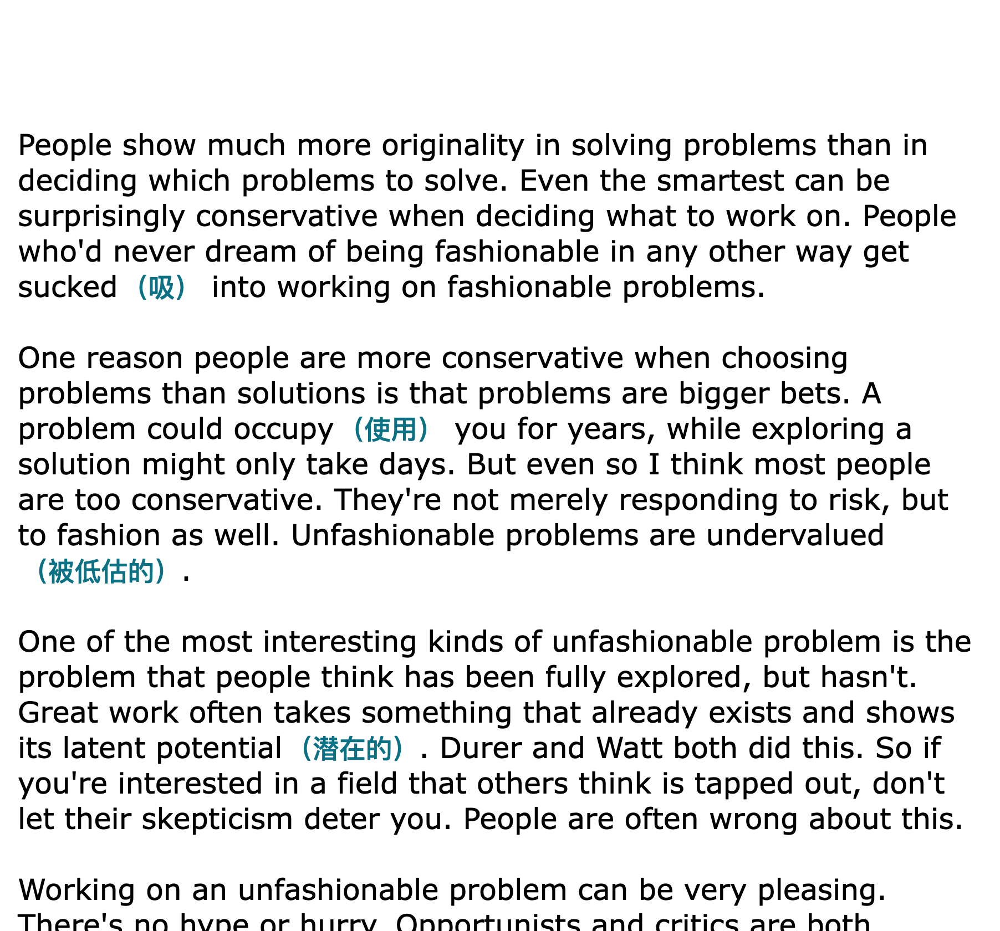
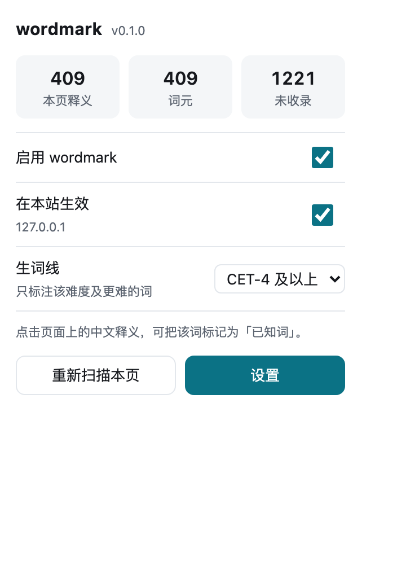
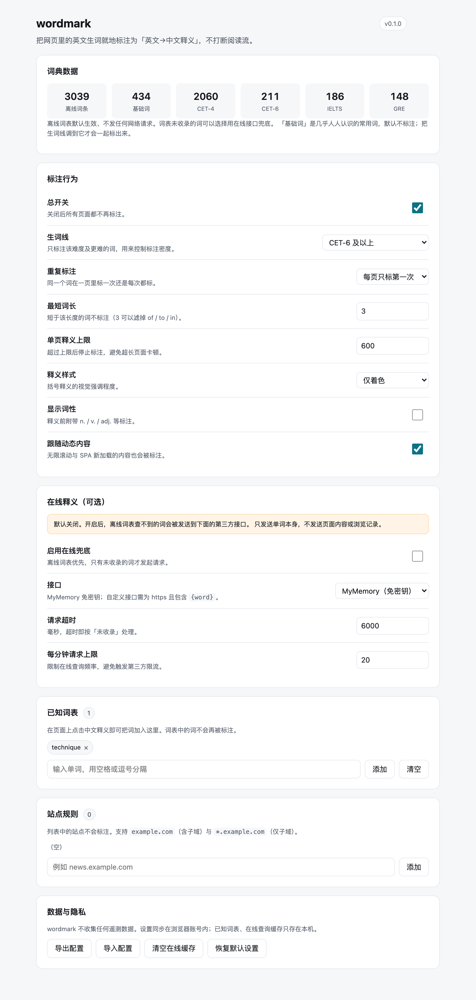

# wordmark

> 把网页里的英文生词就地标注成「英文→中文释义」，不打断阅读流。

阅读英文文章时，最打断节奏的不是生词本身，而是**跳出去查词**：选中 → 切换标签页 → 输入 →
看释义 → 切回来 → 找回原来的位置。wordmark 把这一步压到零：不认识的词，中文释义就写在它后面。

```
Field notes show ephemeral patterns across biodiversity hotspots.
Field notes show ephemeral（转瞬即逝的） patterns across biodiversity（生物多样性） hotspots.
```

* 原文一个字符都不改，只在词后追加释义；关掉开关即可完整还原。
* 默认**纯离线**：3,039 条内置词表，不发任何网络请求。
* 中文释义带 `user-select: none`，选中复制正文时只会带走英文原文。
* 点击中文部分 = 「我认识这个词」，立即从本页和以后的所有页面移除。

---

## 目录

- [安装](#安装)
- [使用](#使用)
- [设置](#设置)
- [在线释义与隐私](#在线释义与隐私)
- [词典数据](#词典数据)
- [架构](#架构)
- [开发](#开发)
- [测试与验证](#测试与验证)
- [用真实文章测试](#用真实文章测试)
- [真浏览器验证](#真浏览器验证)
- [设计取舍](#设计取舍)
- [已知限制](#已知限制)
- [许可](#许可)

---

## 安装

需要 Node.js ≥ 20 与 Chrome ≥ 114。

```bash
git clone git@github.com:ascult/wordmark.git
cd wordmark
npm install
npm run check     # 词典合并 → 类型检查 → lint → 单测 → 构建 → 构建校验 → 冒烟测试
```

然后在 Chrome 里加载：

1. 打开 `chrome://extensions/`；
2. 右上角打开「开发者模式」；
3. 点「加载已解压的扩展程序」，选择仓库里的 **`dist/`** 目录。

改完代码后重新执行 `npm run build`，回到扩展页点一次刷新即可。

## 使用

| 操作 | 结果 |
| --- | --- |
| 正常阅读 | 正文里的生词后自动出现中文释义 |
| 点击中文释义 | 标记为「已知词」，本页立即移除，之后不再标注 |
| 点扩展图标 | 查看本页标注数量，切换本站开关、调整生词线 |
| 打开设置页 | 已知词表、站点规则、在线兜底、导入导出 |

标记过的词会写进已知词表，可以在设置页里按词删除，也可以整表清空。

## 设置

设置页按「标注行为 / 在线释义 / 已知词表 / 站点规则 / 数据与隐私」分组，几个关键项：

| 设置 | 默认 | 说明 |
| --- | --- | --- |
| 生词线 | CET-4 及以上 | 只标注该难度及更难的词，用来控制标注密度。实测 CET-4 ≈ 每 87 词一处，CET-6 ≈ 每 359 词一处；调到「基础词」是最密档 |
| 重复标注 | 每页只标第一次 | 改成「每次都标」适合精读，代价是整页中文变多 |
| 最短词长 | 3 | 滤掉 of / to / in 这类短词 |
| 单页释义上限 | 600 | 防止超长页面卡顿 |
| 释义样式 | 仅着色 | 另有下划线、底色块 |
| 跟随动态内容 | 开 | 无限滚动 / SPA 新加载的内容也会被标注 |
| 站点规则 | 空 | 支持 `example.com`（含子域）与 `*.example.com`（仅子域） |

设置存在 `chrome.storage.sync`（可随浏览器账号同步，体积 < 2KB）；
已知词表和在线查询缓存存在 `chrome.storage.local`（只在本机）。

## 在线释义与隐私

内置词表覆盖 3,039 条中高频生词；查不到的词可以选择用在线接口兜底，**默认关闭**。

开启后：

* 只有**单词本身**会被发出去，页面内容、URL、浏览记录都不会离开浏览器；
* 请求集中在 service worker 里发起，不受站点 CORS / CSP 影响，多标签页共享缓存与限流；
* 默认接口是免密钥的 [MyMemory](https://mymemory.translated.net/)，也可以填自定义接口：
  需要 https 地址模板（含 `{word}` 占位符）与释义字段的点路径（如 `data.0.gloss`），
  并在设置页点「授予权限」单独授权该域名（`optional_host_permissions`，不是安装时全量授权）。
* 第三方返回的文本按**不可信数据**处理：先清洗（去标签、去控制字符、限长、必须含中文），
  再用 `textContent` 写入 DOM，永远不会被当成 HTML 解析。

wordmark 不收集任何遥测数据，没有分析脚本，没有远程配置。

## 词典数据

词表分两层，`npm run dict` 合并校验后生成 `src/data/dict.zh.json` 打进扩展：

| 层 | 目录 | 规模 | 说明 |
| --- | --- | ---: | --- |
| 人工整理 | `data/parts/*.json` | 747 条 | 逐条核对过的生词，**冲突时优先** |
| 外部导入 | `data/imported/*.json` | 2,292 条 | 从 TypeWords 的 CET-4 全表转换而来 |
| **合计** | | **3,039 条** | |

难度分五档，`basic` 是「几乎人人认识的常用词」，默认不标注：

| 难度 | 词条数 | 默认标注 |
| --- | ---: | :---: |
| basic（基础词） | 434 | ✗ |
| CET-4 | 2,060 | ✓ |
| CET-6 | 211 | ✓ |
| IELTS | 186 | ✓ |
| GRE | 148 | ✓ |

每条记录形如：

```json
{ "word": "ephemeral", "pos": "adj.", "gloss": "转瞬即逝的", "level": "gre" }
```

`alt` 字段可选，用于不规则变体反查（如 `child` → `["children"]`）。
合并脚本会强制校验：词元必须是小写 ASCII、唯一、释义 ≤ 14 字且含中文、难度必须在五档之内，
且 `alt` 不能与正式词条同名——**任何一条不合格都会让构建失败**，坏数据进不了扩展。

### 借用 TypeWords 的 CET-4 词库

[TypeWords](https://github.com/zyronon/TypeWords)（GPL-3.0，与本项目同许可）公开仓库里带了一份
CET-4 词库 `public/dicts/en/word/CET4_T.json`，2,607 条，字段很全（词性 + 详细中文释义 + 例句 + 词源）。
wordmark 借用的是其中的 `word` 与 `trans` 两个字段。

```bash
git clone --depth 1 git@github.com:zyronon/TypeWords.git .tmp-ref/TypeWords   # 只作数据来源，不入库
npm run import:dict -- .tmp-ref/TypeWords/public/dicts/en/word/CET4_T.json cet4 data/imported/cet4.json \
  --common=data/reference/common-words-a.json --common=data/reference/common-words-b.json
npm run dict && npm run build:prod
```

转换时做了三件事，都有测试兜着（`tests/import.condense.test.mjs`）：

1. **长释义压成短释义**：源数据 `cn` 常 30–80 字（完整词典释义），wordmark 要的是 ≤14 字的内联短释义
   ——取第一个义项、按标点切出首小句，再按括号位置决定去留：句尾的补充说明丢掉（`取消（计划好的事情）` → `取消`），
   句中的限定语保留内容（`在（船、飞机、火车等）上` → `在船、飞机、火车等上`，否则会压成残句 `在上`）。
2. **滤掉匹配不到的条目**：分词器按连字符切词，所以带连字符/空格的 5 条直接丢弃。
3. **按常用度分档**：落进常用词表的词标为 `basic`（默认不标注），其余保留 CET-4。
   否则整表导入会把 `ability`、`action`、`account` 这类人人认识的词糊满页面。

第三步用的两份常用词表在 `data/reference/`，是**由模型生成的**、不是权威词频表，
只用来做「这词是不是常见到不必标注」的成员判断。这一层的判断误差影响很小（某个词标或不标），
但它是**可替换**的：换成 COCA / BNC 之类的真实词频表，只要 `--common=` 指过去即可。
TypeWords 仓库里没有 CET-6/IELTS/GRE 词库（其余词库在它的服务端），所以这次只借到了 CET-4。

### 自己扩充

往 `data/parts/` 加 JSON 即可（外部来源放 `data/imported/`）；或者用
`npm run try -- <url> --dump-missing` 从自己常读的文章里采集漏词，再补进来。

## 架构

```
src/
├── core/                 与运行环境无关的纯逻辑（全部可单测）
│   ├── tokenizer.ts      英文分词：撇号、连字符、缩写、缩写词过滤
│   ├── lemmatizer.ts     词形还原：有序候选词元 + 高频不规则表
│   ├── annotator.ts      标注决策：难度阈值、已知词、重复策略
│   ├── settings.ts       设置模型 + 校验收敛 + 存储（无 chrome 时退化为内存）
│   ├── messages.ts       content ↔ service worker 的消息协议
│   ├── lru.ts            LRU 缓存
│   └── types.ts          共享类型
├── dict/                 可插拔词典
│   ├── offline.ts        内置词表 provider（同步命中快路径）
│   ├── remote.ts         在线 provider（MyMemory / 自定义接口）
│   └── registry.ts       编排：候选词元 → 本地 → 远程 → 正负缓存
├── content/              页面侧
│   ├── dom-walker.ts     找出值得标注的文本节点（跳过代码块/表单/隐藏区）
│   ├── gloss-renderer.ts 就地插入释义，并支持精确回滚
│   ├── observer.ts       MutationObserver 增量处理动态内容
│   ├── pipeline.ts       批处理流水线（可在 jsdom 下单测）
│   ├── index.ts          接线：设置、生命周期、点击与消息
│   └── styles.css        声明式注入的样式（兼容严格 CSP）
├── background/index.ts   MV3 service worker：在线查询、缓存、限流、持久化
├── popup/                弹窗：本页统计与快捷开关
├── options/              设置页
└── manifest.json         MV3 manifest（版本号从 package.json 注入）
```

一次标注的数据流：

```
DOM 文本节点
  → DomWalker 过滤（代码块 / 表单 / 隐藏 / 已标注）
  → tokenizer 分词 + isCandidateToken 预筛
  → 整批收集候选词 → DictionaryRegistry.resolveMany
        ├─ lemmaCandidates 生成有序词元候选
        ├─ 本地词表同步命中（绝大多数情况到此为止）
        ├─ 未命中 → 消息转发 service worker → 在线接口（可选、限流、持久缓存）
        └─ 正 / 负结果都进 LRU，长文不重复查询
  → annotator 决策（难度阈值 + 已知词 + 重复策略 + 单页上限）
  → GlossRenderer 把文本节点切成 [原文][标注][原文]
  → MutationObserver 接住后续动态内容
```

## 开发

```bash
npm run dev        # esbuild watch（改 HTML/CSS 需重跑一次）
npm run build      # 一次性构建（含 sourcemap）
npm run build:prod # 生产构建（压缩、无 sourcemap）
npm run dict       # 合并校验 data/parts/*.json → src/data/dict.zh.json
npm run icons      # 重新生成图标（纯几何 + 4×4 超采样，零依赖）
npm run typecheck  # tsc --noEmit
npm run lint       # eslint（typescript-eslint 扁平配置）
npm run test       # vitest（jsdom 环境）
npm run validate   # 校验 dist 产物：manifest 自洽、资源齐全、无 eval
npm run smoke      # 把 dist/content.js 加载进 jsdom 做端到端冒烟
npm run smoke:ui   # 用假 chrome API 真实加载弹窗 / 设置页，验证渲染与消息
npm run verify:browser # 真 Chromium 加载扩展：截图 + 真实点击 + 19 项运行时断言
npm run try -- <url>   # 拿一篇真实文章跑一遍，报告覆盖率 / 完整性 / 漏词
npm run bench      # 固定 6 篇真实文章的对照表（--levels 出密度曲线，--save/--compare 存档对比）
npm run import:dict -- <源> <难度> <输出> [--common=...]   # 从外部词库导入并分档
npm run check      # 以上全部串起来，CI 用这一条
npm run zip        # 打包成可上传的应用商店 zip
```

图标不依赖任何图形库：`scripts/generate-icons.mjs` 用几何图形 + 超采样在内存里画图，
再手写 PNG 编码（IHDR/IDAT/IEND + zlib），所以仓库里没有需要维护的二进制素材。

## 测试与验证

153 个单元 / 集成测试，加上四层产物级验证：

| 层次 | 内容 |
| --- | --- |
| 纯逻辑 | 分词、词形还原、难度判定、重复策略、LRU、设置收敛与导入清洗 |
| 数据 | 3,039 条词表的 schema、唯一性、排序、五档覆盖、`alt` 冲突 |
| 数据转换 | 外部词库的长释义压缩规则（括号位置、语域标注、截断、拒绝非中文） |
| DOM | 代码块/表单/可编辑区/隐藏节点/自身产物的跳过规则 |
| 渲染 | 多处标注的文本拼接、重叠区间防御、`unmarkAll` 精确还原、**重扫后重新标满整页** |
| 流水线 | jsdom 下跑完整标注链：阈值、已知词、幂等性、单页上限、XSS 回归 |
| 网络 | 假 fetch 下的成功 / 非 2xx / 超时 / 自定义接口 / 释义清洗 |
| 产物 | `validate-dist` 查 manifest 与资源引用；`smoke-dist` 加载真实 bundle |
| 界面 | `smoke-ui` 真实加载 `options.html` / `popup.html`（连 `<script src>` 一起）：表单回填、条件显示、权限提示、消息字段与通道、无未捕获异常 |
| 真实文章 | `try-article` / `article-bench` 把构建产物喂给线上文章，见下一节 |
| 真浏览器 | `verify:browser` 用 CDP 驱动 Chromium 加载扩展，截图 + 19 项功能断言，见[真浏览器验证](#真浏览器验证) |

### 产物级测试抓到过的真实缺陷

jsdom 跑得再全，也只是「我以为的浏览器」。下面这些全部是产物级测试（尤其是真浏览器那一层）抓出来的：

| # | 缺陷 | 后果 | 现在由谁守住 |
| --- | --- | --- | --- |
| 1 | MutationObserver 晚于首次扫描建立 | 两者之间新增的节点漏标注 | `smoke-dist` |
| 2 | 设置页权限提示读的是改动前的值 | 改了接口地址却显示上一次的授权状态 | `smoke-ui` |
| 3 | 弹窗直接读 `tab.url`，而它需要额外权限 | **任何站点都显示「不支持」，统计永远是 `–`** | `verify:browser` + `validate-dist` 静态守卫 |
| 4 | 重扫时把「渲染器自己创建的文本节点」当作自己的产物跳过 | **改一次设置，标注就从 410 掉到 9** | `pipeline.test.ts` 回归用例 |
| 5 | 长释义压缩把句中括号直接删掉 | `在（船、飞机、火车等）上` 压成残句「在上」 | `import.condense.test.mjs` |

第 3、4 条都**只有真浏览器**能发现：前者依赖 `chrome.tabs.query` 在真实权限模型下的返回值，
后者依赖「设置变更 → storage 事件 → 热重扫」这条只有运行时才存在的链路。

## 用真实文章测试

上面那些测试用的句子都是我自己挑的，容易自我印证。所以另有一个测试台，
把**构建产物**（不是源码）直接喂给线上文章：

```bash
npm run try -- https://paulgraham.com/greatwork.html   # 单篇：覆盖率 / 完整性 / 阅读密度 / 漏词清单
npm run try -- <url> --level=cet6                      # 换生词线再跑一遍
npm run try -- <url> --dump-missing                    # 导出漏词清单，用来补词表
npm run bench                                          # 固定 6 篇的对照表
npm run bench -- --levels                              # 逐个生词线的密度曲线
npm run bench -- --save=before.json                    # 存档当前基线
npm run bench -- --compare=before.json                 # 与基线对比（±pp）
```

样本刻意做杂：长篇随笔、技术博客、科普长文、杂志首页、19 世纪小说。
抓下来的 HTML 会缓存到 `.tmp-articles/`，保证前后对比用的是同一份页面。

默认配置（生词线 CET-4，词表 3,039 条）下的实测：

| 文章 | 正文字符 | 内容词 | 命中 | 释义 | 内容词覆盖率 | 完整性 | 耗时 |
| --- | ---: | ---: | ---: | ---: | ---: | :---: | ---: |
| How to Do Great Work | 69,349 | 1,723 | 410 | 410 | 18.8% | ✓ | 606ms |
| How To Be Successful（Sam Altman） | 19,574 | 749 | 151 | 152 | 15.1% | ✓ | 534ms |
| Measurement, benchmarking…（Dan Luu） | 36,498 | 1,355 | 245 | 247 | 13.7% | ✓ | 607ms |
| The AI Revolution Part 1（Wait But Why） | 47,531 | 1,586 | 331 | 342 | 15.9% | ✓ | 830ms |
| Smithsonian Magazine 首页 | 24,062 | 654 | 102 | 117 | 10.1% | ✓ | 721ms |
| Pride and Prejudice（Gutenberg） | 738,343 | 6,758 | 600 | 600 | 8.0% | ✓ | 1,016ms |

**阅读密度**（每千运行词标注多少处）才是决定「读起来累不累」的指标，所以 `--levels` 会把
五档生词线各跑一遍：

| 生词线 | 插入释义 | 内容词覆盖率 | 阅读密度 | 完整性 |
| --- | ---: | ---: | ---: | :---: |
| 基础词及以上（最密） | 2,381 | 18.2% | 14.7 处/千词 | ✓ |
| **CET-4 及以上（默认）** | **1,868** | **14.3%** | **11.5 处/千词** | ✓ |
| CET-6 及以上 | 453 | 3.5% | 2.8 处/千词 | ✓ |
| IELTS 及以上 | 173 | 1.3% | 1.1 处/千词 | ✓ |
| 仅 GRE（最稀） | 47 | 0.4% | 0.3 处/千词 | ✓ |

**但这个合计值有很强的误导性**：《傲慢与偏见》占了语料 80% 的词数（13 万词），而它的生词密度
极低，把平均值拉了下来。按篇看才是真实体感：

| 文章 | CET-4（默认） | CET-6 |
| --- | ---: | ---: |
| Smithsonian 杂志首页 | 每 16 词一处 | 每 123 词一处 |
| Sam Altman 随笔 | 每 23 词一处 | 每 116 词一处 |
| Wait But Why 科普长文 | 每 23 词一处 | 每 102 词一处 |
| Dan Luu 技术博客 | 每 25 词一处 | 每 132 词一处 |
| Paul Graham 随笔 | 每 30 词一处 | 每 119 词一处 |
| 傲慢与偏见（19 世纪小说） | 每 218 词一处 | 每 726 词一处 |

结论有两面：**现代非虚构文章上，默认档大约是每句一个释义**（这是「边读边学」的密度，
不是「轻量辅助」的密度）；想更轻就把生词线调到 CET-6，立刻变成每 5–6 句一个。
19 世纪小说则两边都很稀——它的生词本来就大量落在四六级/雅思词表之外。
默认值该定在哪一档，取决于你想要的是「精读」还是「顺读」，**我没有替你改**，
数据摆在这里，改起来就是设置页里的一下点击。

词表规模的三次变化（同一套文章、同一份页面）：

| 阶段 | 词表 | 命中词元 | 内容词覆盖率 |
| --- | ---: | ---: | ---: |
| 初始人工词表 | 570 | 433 | 3.4% |
| 用真实漏词补一批 | 747 | 842 | 6.6% |
| 借入 TypeWords 的 CET-4 | 3,039 | 1,839 | 14.3% |

### 两轮测试各推翻了一个想当然

**第一轮：频次和「是不是生词」是负相关的。** 我原以为可以「按出现频次补词」，但把漏词按频次排序后，
前 20 名几乎全是 `the / you / and / that / have` —— 最高频的词恰恰最不该标注。
所以补词表只能按难度判断；流程改成先用 `--dump-missing` 导出漏词，
再人工筛掉功能词、专有名词与基础词，只留真正 CET-6/IELTS/GRE 级的（采了 179 个，净增 177 条）。

**第二轮：只加词不管密度，会让工具变难用。** 把 CET-4 全表 2,602 条直接并进来后，覆盖率跳到 18.2%，
但默认标注的是 `ability`、`action`、`account` 这类人人认识的词——密度上去了，阅读体验反而变差。
这就是 `basic` 档存在的原因：整表导入后按常用度切开，把最常用的一批挡在默认之外（18.2% → 14.3%）。

测试台同时守住两条底线：**完整性**（摘掉释义后六篇正文都逐字还原原文，`[data-wordmark]` 零残留）
与**稳定性**（六篇全部零未捕获异常，73.8 万字符的《傲慢与偏见》1 秒跑完、jsdom 环境）。

## 真浏览器验证

jsdom 再怎么测，测的也是「我以为的浏览器」。所以另有一条真浏览器链路：

```bash
npm run verify:browser          # 启动本地 Chromium 加载 dist/，截图 + 19 项断言
npm run verify:browser -- --article=<缓存文章文件名>
```

**没有引入 puppeteer / playwright。** Node 24 自带 `fetch` 与 `WebSocket`，而 CDP 本来
就是「WebSocket + JSON」，直接说协议更省依赖也更可控。脚本做四件事：

1. 起一个本地静态服务器，把 `npm run bench` 抓下来的**真实文章**喂进去
   （内容脚本只跑在 http/https 上，`file://` 不匹配 `<all_urls>`）；
2. 用 `--load-extension=dist --disable-extensions-except=dist` 启动无头 Chromium，
   从 service worker 目标里取出扩展 ID——这是 MV3 运行时才有、静态检查拿不到的信息；
3. 用 `Input.dispatchMouseEvent` 打**真实点击**（不是 `element.click()`），走完整事件链；
4. 逐项断言并截图，最后把三张有代表性的图更新到 `docs/screenshots/`。

| | | |
| --- | --- | --- |
|  |  |  |
| 正文里的释义（真实排版、真实字号） | 弹窗读到本页真实统计 | 设置页的五档词表 |

断言覆盖的是 jsdom 给不了的东西：

- **真实计算样式**：释义 12px < 正文 13px、`user-select: none`（复制正文不会带走中文）；
- **真实点击**：点在中文释义上，该词释义从 1 处变 0 处并弹出「已标记为已知词」提示；
- **真实消息往返**：弹窗从内容脚本读到本页 409 处标注、1221 个未收录词；
- **真实运行时联动**：弹窗把生词线切到 CET-6 后，已打开的页面热重扫 `410 → 102 处`，
  与**冷启动重载**的结果（102）一致，且**反复重扫不衰减**（102 → 102）；
- 整轮零页面级 JS 异常。

> 本机需要的额外开关：Chromium 自身的沙箱在这个环境里初始化会被拒，所以脚本带 `--no-sandbox`。
> 这是环境限制，不影响结论。

**这条链路能证明什么、不能证明什么**：它能证明扩展在真实 Chromium 的 MV3 运行时里
加载、注入、渲染、点击、消息、存储联动都正常；不能替代人工确认视觉细节
（无头渲染、缓存的是 Paul Graham 那种极简 HTML，没有复杂站点的排版冲突）。
无头浏览器也没有工具栏，点不到扩展图标，所以「用户点击图标后才授予 activeTab」这类流程
在这里测不了——也正是这一点促成了下面那个设计改动。

## 设计取舍

* **内联标注而不是浮层/弹窗**：产品目标就是「保持阅读流」，浮层仍然要求眼睛离开正文。
* **只用 textContent / DocumentFragment 写 DOM**：不拼 HTML 字符串，远程释义天然无法注入。
* **样式走 manifest 声明式注入**：不用 `<style>`、不用内联 style 属性，严格 CSP 的站点也照常生效。
* **点击只认中文部分**：点英文原词仍然正常跳链接，不会悄悄吃掉用户的点击。
* **弹窗不读 `tab.url`，改问内容脚本**：读 `tab.url` 需要 `tabs`（多一条「读取浏览历史」警告）
  或 `activeTab` 权限，而少了权限时它只会返回空串——真浏览器实测所有站点都显示「不支持」。
  内容脚本本来就知道自己在哪个站点、标注了多少，直接问它既省掉权限，也让这条路径可被自动验证。
* **重扫不能按「节点是不是自己创建的」过滤**：第一次渲染后正文大部分躺在渲染器插入的
  间隙文本节点里，那样过滤会让标注逐次衰减。幂等性应由「标注外壳的后代一律跳过」保证。
* **在线默认关闭、单词级最小化外发**：隐私优先，且把「会外发」这件事写在设置页上而不是藏在代码里。
* **正负缓存都做**：长文里未收录的词会反复出现，没有负缓存就会反复打在线接口。
* **难度阈值即「生词线」**：不猜用户会不会，而是让用户按 CET-4/6 → IELTS → GRE 自己调密度。
* **`knownWords` 放 local 而非 sync**：它会长到几千条，超过 sync 的单键 8KB 配额。

## 已知限制

* 词表 3,039 条（其中 CET-4 全表借自 TypeWords）：命中率仍靠「在线兜底」补齐，
  或者用 `npm run try -- <url> --dump-missing` 从你常读的文章里采集漏词，再按 `data/parts/` 的格式补进去。
* `all_frames: false`：iframe 内的正文不会被标注。
* 不进入 shadow DOM（Web Component 站点会有遗漏）。
* 在线接口是机翻质量，长释义会被截断到 24 字；只保证「不影响本地标注」。
* service worker 会被浏览器随时回收，限流窗口因此是「尽力而为」的。

## Roadmap

- [x] 借用外部词库（TypeWords CET-4 全表，已并入）
- [ ] 换成真实词频表（COCA / BNC）替换 `basic` 档的模型生成常用词表
- [ ] 接入 CET-6 / IELTS / GRE 外部词库（TypeWords 公开仓库里没有）
- [ ] shadow DOM 与 iframe 支持
- [ ] 阅读统计：本页/本周接触过的生词
- [ ] 生词本导出到 Anki / CSV
- [ ] Firefox (MV3) 与 Safari 适配

## 许可

GPL-3.0-or-later，见 [LICENSE](LICENSE)。
